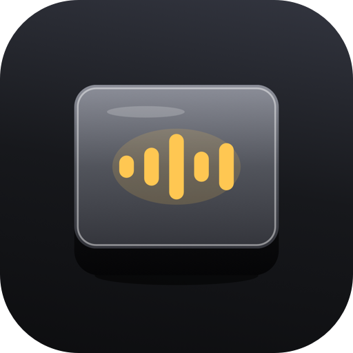
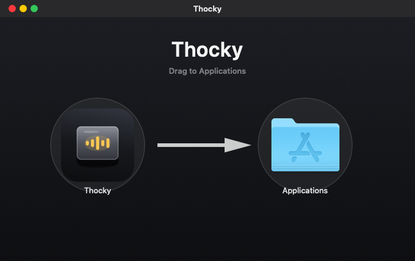
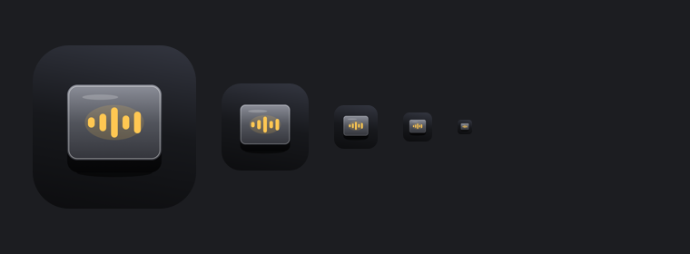

# Thocky

<p align="center">
  
</p>

<h3 align="center">Mechanical keyboard sounds for your MacBook — picked by how hard you actually type.</h3>

<p align="center">
  <a href="https://github.com/Jasonilization/thocky/releases"></a>
  
  <a href="LICENSE"></a>
  
</p>

---

Thocky listens to the accelerometer inside your MacBook's chassis. A light tap stays quiet, a normal press sits in the middle, and a slammed key lands on the slam tier. The mix is continuous, so a slightly harder press never flips from one sample to another. No account, no network, no telemetry. It reads key codes, never characters.

```
keystroke ──► event tap ─────────────► which key, and where it sits
     │
     └──► SPU accelerometer
              │  gravity removed, noise floor, impact peak
              ▼
          force 0…1 ──► crossfade the two nearest tiers
              │
              ▼
          clip ──► voice ──► pan by key position ──► speakers
```

## What it does

- **Force-sensitive sound** — reads the built-in SPU accelerometer at ~800 Hz through IOKit (no root, no kernel extension) and scores every keystroke from its real impact peak.
- **Continuous crossfade** — force is a 0…1 value across four tiers; the mixer blends the two nearest clips instead of stepping between them.
- **Positional audio** — equal-power pan by key position, a sub-millisecond lead to the near ear, and a touch less level for the back row.
- **Live keyboard view** — **Show keyboard** draws your MacBook deck; the key you hit lights and sinks by how hard the sensor measured it, tinted from blue (soft) to red (slam). Guesses stay grey.
- **16 sound packs** — Cherry MX, Alps, Topre, Holy Pandas, Ink, Cream, a buckling spring, plus synthesised scissor, membrane and typewriter.
- **Calibration** — 8 seconds of normal typing sets soft and slam for your desk and your hands.
- **Graceful fallback** — no sensor, or a macOS update broke it? Thocky still plays, estimating force from typing rhythm.
- **Real-time C audio engine** — one Core Audio output unit, clips in RAM, a lock-free trigger ring, a fixed voice pool, round-robin takes, and an idle pause after three minutes of silence.
- **Menu bar only** — a waveform icon, no Dock icon.

## Screenshots

<p align="center">
  
</p>
<p align="center"><em>The installer. Open the disk image and drag Thocky onto Applications.</em></p>

<p align="center">
  
</p>
<p align="center"><em>The icon at every size macOS draws it, down to the 16pt menu.</em></p>

## 📦 Requirements

| | |
|---|---|
| **OS** | macOS 13 (Ventura) or newer |
| **Hardware** | Apple Silicon MacBook (tested on an M5 MacBook Air) — the accelerometer is optional |
| **Build** | Swift toolchain — Command Line Tools are enough, no Xcode required |
| **Perms** | Accessibility (to observe key events) |

## 🚀 Installation

```bash
git clone https://github.com/Jasonilization/thocky.git
cd thocky
make dmg     # → .build/dmg/Thocky-1.0.dmg
open .build/dmg/Thocky-1.0.dmg
```

Drag **Thocky** onto **Applications**. First launch: right-click → **Open** (the app is signed with a local certificate, not notarized), then grant Accessibility when asked.

## 🎚️ How it works

**Sensing.** `AppleSPUHIDDevice` reports accelerometer samples at about 800 Hz. Thocky opens it through IOKit (`Sources/ThockSPU`) and reads three int32 Q16 values per report. Samples are stamped with `mach_absolute_time()` in process, so key events and chassis vibration share one clock.

**Force.** `Sources/Thocky/ForceDetector.swift` removes gravity with a slow per-axis average (frozen while a strike is in flight), tracks a noise floor that falls quickly on a quiet desk and rises slowly when the machine is handled, then gates impacts and holds the peak. The event tap can run a few milliseconds ahead of or behind the vibration, so the matcher looks both ways instead of waiting for the strike to decay. Tier boundaries sit at 0.25, 0.5 and 0.75.

**Calibration.** **Calibrate force sensor…** asks you to type normally for 8 seconds and takes the 35th and 92nd percentile of those peaks. Until then: soft at or below 7.5 mg, slam at or above 140 mg.

**Keyboard.** `Sources/Thocky/KeyLayout.swift` is one US MacBook layout with real key widths — tab, return, shift and space are the wide caps they are in aluminium — shared by the panner and the window. Each cap lights with the force of the last press: brighter as the measured peak climbs, coloured by tier from blue (soft) to red (slam), and it sinks a little while the press is in flight. A keystroke with no sensor reading lights grey, so an estimated force never looks like a measured one.

Checked on a MacBook Air (M5, macOS 27.2): the SPU stream opens without root at about 805 Hz, Core Audio settles at 48 kHz / 128 frames, and the offline render plays every voice with nothing dropped.

## 🎹 Sound packs

alpaca · blackink · bluealps · boxnavy · buckling · cream · holypanda · membrane · mxblack · mxblue · mxbrown · redink · scissor · topre · turquoise · typewriter

Each pack has four key groups (generic, return, space, backspace), press and release, and four force tiers, with up to five takes per slot. Built from the MIT-licensed [Mechvibes/ClickClack](https://github.com/cesarferreira/clickclack) recordings; scissor, membrane and typewriter are synthesised. Regenerate with `make packs`.

## 🔒 Privacy & permissions

**Accessibility** is required to observe key events. Every keystroke-sound app on macOS needs it, which is why this kind of app ships outside the App Store. Thocky asks on first launch; you can also use **Grant Accessibility access…** in the menu, or System Settings → Privacy & Security → Accessibility.

- Thocky reads **key codes only** — it never sees characters and never stores what you type.
- The tap is **listen-only**, so a slow sensor read can never hold your keys back.
- **No network code.** Nothing leaves your Mac.

The accelerometer needs no permission. It is a private interface, so a macOS update can break it — when that happens, Thocky falls back to rhythm-based force.

## 🛠️ Development

Pure SwiftPM — no Xcode project:

```bash
make app            # Thocky.app, signed with a local codesigning identity
make run            # build and open it
make dmg            # drag-to-install disk image
make test-offline   # mix a WAV through the engine, no output device
make packs          # rebuild the 16 packs (needs numpy)
make clean
```

The bundle lands in `.build/app/<configuration>/Thocky.app`, outside SwiftPM's product directory, so a later `swift build` doesn't delete it.

| Variable | Effect |
|---|---|
| `KS_FORCE_TEST=1` | synthetic impacts through the force detector |
| `KS_SELFTEST=1` | scripted playback, then render and voice counts |
| `THOCK_DEBUG=1` | verbose Core Audio logging |
| `KS_PACKS=…` | override the pack directory |
| `THOCKY_SIGN_ID=…` | codesign identity, so Accessibility survives a rebuild |

Logs: `~/Library/Logs/Thocky/thocky.log`.

```
Sources/
├── ThockAudio/     C audio engine, pack cache, WAV reader
├── ThockSPU/       C bridge to the SPU accelerometer
└── Thocky/         Swift app: sensor, force, keys, menu, keyboard
Tools/              generate_packs.py, engine_test.c
scripts/            build_app.sh, build_dmg.sh, build_packs.sh, render_branding.swift
Resources/Packs/    16 packs
```

## 🧯 Troubleshooting

**No sound, and `say hello` hangs.** Something else is sitting on the output device. System-wide EQ apps can leave it wedged after they quit. Quit or reinstall them, then `sudo killall coreaudiod` (launchd restarts it). The log heartbeat reports `renders=0` when the engine is up but the audio server isn't pulling.

**The render count is climbing, but typing is silent.** The event tap wasn't created, or it was created and macOS is dropping its events. Grant Accessibility and hit **Re-check** in Settings. `make test-offline` and `KS_FORCE_TEST=1` bypass the tap.

**macOS says the tap exists but nothing works.** macOS creates an event tap for an untrusted process and then discards every event in silence, so the app looks healthy and hears nothing. The heartbeat reports `tap=1 trust=0` when this happens, and the menu turns red with `⚠️ No key events: Accessibility is granted to a different Thocky`. The grant is per code identity, so rebuilding the app or running it from a different path needs a fresh toggle: open System Settings → Privacy & Security → Accessibility and switch **every** Thocky entry on. Signing with a local certificate (`THOCKY_SIGN_ID`, the default when one exists) keeps a grant alive across rebuilds; ad-hoc signing does not, because ad-hoc rebuilds change the binary's hash and TCC follows the hash.

## 🗺️ Roadmap

- [x] Real-time C audio engine
- [x] Accelerometer force sensing + calibration
- [x] Positional stereo
- [x] Live 2D keyboard view
- [x] 16 sound packs
- [x] Drag-to-install DMG
- [ ] Notarized release builds
- [ ] More keyboard layouts (ISO, JIS)

No timelines. It ships when it ships.

## 🙏 Credits

Switch recordings: [Mechvibes/ClickClack](https://github.com/cesarferreira/clickclack), MIT (Tiago Ferreira). The force path follows the same idea as Thock and Haptyk, implemented here against the raw HID reports. SwiftPM, AppKit, SwiftUI and Core Audio — no third-party dependencies.

## 📜 License

MIT — see [LICENSE](LICENSE).
